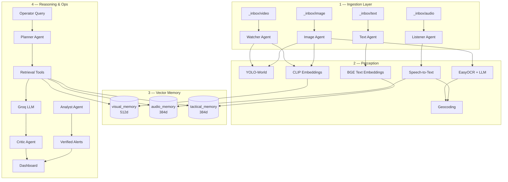

# Aegis

### Multimodal Crisis Command Center

[](LICENSE)
[](https://www.python.org/)
[](https://qdrant.tech/)
[](https://groq.com/)
[](https://docs.ultralytics.com/)
[](https://streamlit.io/)

**Aegis** is an open-source AI system for **crisis situational awareness**.  
It ingests **video, image, audio, and text**, indexes them into modality-aware vector memory, and answers operator questions with **cited evidence**, planner/critic agents, and a live command dashboard.

<p align="center">
  
</p>

<p align="center">
  <a href="#architecture-breakdown">Architecture</a> ·
  <a href="#features">Features</a> ·
  <a href="#use-cases">Use Cases</a> ·
  <a href="#quick-start">Quick Start</a> ·
  <a href="#documentation">Docs</a> ·
  <a href="#evaluation--research">Research</a> ·
  <a href="#license">License</a>
</p>

---

## Table of contents

1. [About](#about)
2. [Architecture breakdown](#architecture-breakdown)
3. [Features](#features)
4. [Use cases](#use-cases)
5. [Tech stack](#tech-stack)
6. [Quick start](#quick-start)
7. [Project structure](#project-structure)
8. [Documentation](#documentation)
9. [Evaluation & research](#evaluation--research)
10. [Roadmap](#roadmap)
11. [Contributing](#contributing)
12. [License](#license)

---

## About

During disasters, critical signals are fragmented across CCTV, radio nets, field photos, and tactical reports. Analysts spend precious time stitching modalities by hand — and ungrounded AI answers are unsafe.

Aegis frames crisis intelligence as **multimodal retrieval + agentic reasoning**:

| Step | Capability |
|------|------------|
| **1. Ingest** | Specialized agents watch hot-folders for video, image, audio, and text |
| **2. Understand** | YOLO-World detection, CLIP/BGE embeddings, OCR, speech-to-text, geocoding |
| **3. Remember** | Qdrant collections: visual (512d) + audio/tactical/session (384d) |
| **4. Retrieve** | Hybrid vector search + metadata/keyword filters |
| **5. Reason** | Tool-using LLMs with planner, critic, and episodic memory |
| **6. Verify** | Autonomous analyst cross-checks modalities; provenance logs every answer |
| **7. Operate** | Streamlit command map, semantic search, chat, and live alerts |

> **Disclaimer:** Aegis is a research / demonstration command-center prototype. Life-safety decisions must remain **human-in-the-loop**.

---

## Architecture breakdown

Aegis is organized as four cooperating layers.

### Layer view

```text
┌─────────────────────────────────────────────────────────────────────────┐
│                        COMMAND DASHBOARD (Streamlit)                     │
│         Crisis Map  ·  Semantic Search  ·  AI Chat  ·  Live Alerts       │
└────────────────────────────────┬────────────────────────────────────────┘
                                 │
┌────────────────────────────────▼────────────────────────────────────────┐
│                     AGENTIC REASONING & SAFETY                           │
│   Planner  ·  Critic  ·  Analyst  ·  Episodic Memory  ·  LLM Manager     │
│                    Retrieval Tools  ·  Provenance Logger                 │
└────────────────────────────────┬────────────────────────────────────────┘
                                 │
┌────────────────────────────────▼────────────────────────────────────────┐
│                     VECTOR MEMORY (Qdrant Cloud)                         │
│  visual_memory (CLIP 512d)  │  audio_memory / tactical / session (BGE)   │
└────────────────────────────────┬────────────────────────────────────────┘
                                 │
┌────────────────────────────────▼────────────────────────────────────────┐
│                     MULTIMODAL INGESTION AGENTS                          │
│     Watcher (Video)  ·  Image  ·  Listener (Audio)  ·  Text (SITREP)    │
└─────────────────────────────────────────────────────────────────────────┘
```

### Data & control flow



### Memory collections

| Collection | Dim | Encoder | Stores | Retention |
|------------|-----|---------|--------|-----------|
| `visual_memory` | 512 | CLIP ViT-B/32 | Images & video frames | Permanent |
| `audio_memory` | 384 | BGE-small | Audio transcripts | Permanent |
| `tactical_memory` | 384 | BGE-small | Text / social / SITREPs | Permanent |
| `session_memory` | 384 | BGE-small | Working & episodic context | Session |

### Retrieval pipeline (RAG)

1. **Embed** the query (CLIP for visual collections, BGE for text/audio)  
2. **Search** Qdrant with cosine similarity + score threshold  
3. **Filter** by disaster type, confidence, modality, and location keywords  
4. **Cite** top‑k evidence for the LLM prompt  
5. **Generate** a grounded answer via Groq (with model fallback)  
6. **Critique** unsupported claims / missing citations  
7. **Log** query, evidence IDs, and confidence to `retrieval_logs.json`

### Agent map

| Agent | Responsibility | Primary outputs |
|-------|----------------|-----------------|
| **Watcher** | Video frame sampling, hazard detection, visual indexing | `visual_memory` |
| **Image** | OCR, detection, geo-tagging for still imagery | `visual_memory` |
| **Listener** | STT, transcript enrichment, geocoding | `audio_memory` |
| **Text** | Tactical/social report embedding | `tactical_memory` |
| **Planner** | Decompose multi-step operational questions | Execution plan |
| **Critic** | Hallucination / citation / safety checks | Verified response |
| **Analyst** | Cross-validate visual hazards vs audio intel | `alerts.json` |

For deeper design notes, see [`docs/ARCHITECTURE.md`](docs/ARCHITECTURE.md).

---

## Features

### Multimodal ingestion
- Hot-folder watchers for video, image, audio, and text  
- Open-vocabulary hazard detection (YOLO-World)  
- CLIP visual indexing + BGE text/audio indexing  
- OCR and speech-to-text with city-level geocoding  

### Agentic intelligence
- Strategic retrieval (search vs answer) via tool-using LLMs  
- Explicit **planner** for multi-hop queries  
- **Critic** for grounding and safety  
- **Episodic memory** for multi-turn operator chat  
- **LLM manager** with fallback: Llama-3.3-70B → Mixtral → Llama-3.1-8B  
- Full **retrieval provenance** for auditability  

### Command dashboard
- Operational crisis map  
- Cross-modal semantic search  
- Safety AI chat with confidence badges and plan visualization  
- Zero-latency style alerts from the autonomous analyst  

---

## Use cases

| Scenario | Example operator need | How Aegis helps |
|----------|----------------------|-----------------|
| Urban flooding | “Flood risk near Chennai marina?” | Fuses CCTV frames, radio transcripts, and civic reports with citations |
| Cyclone / weather | Correlate warnings with field audio | Single searchable memory across modalities |
| Infrastructure failure | Locate collapse signals quickly | YOLO-World visuals + tactical notes |
| EOC briefing | Fast Q&A without folder hunting | Natural-language dashboard over indexed evidence |
| Research / teaching | Multimodal RAG lab | Agents, memory, provenance, and benchmarks included |

---

## Tech stack

| Layer | Technology | Role |
|-------|------------|------|
| Vector database | **Qdrant Cloud** | Hybrid vector + payload filtering |
| Text embeddings | **BAAI/bge-small-en-v1.5** (384d) | Fast local CPU embeddings via FastEmbed |
| Visual embeddings | **CLIP ViT-B/32** (512d) | Image / frame semantic search |
| Object detection | **YOLO-World** | Open-vocabulary hazard detection |
| Reasoning | **Groq** (Llama family) | Low-latency grounded Q&A |
| Dashboard | **Streamlit** | Operator UI |
| Geolocation | **Nominatim / geopy** | City-level coordinate grounding |
| Speech | **SpeechRecognition + pydub** | Audio transcription pipeline |

---

## Quick start

### Prerequisites

- Python **3.10+**
- Accounts / keys:
  - [Qdrant Cloud](https://cloud.qdrant.io/) — cluster URL + API key  
  - [Groq Console](https://console.groq.com/) — API key  

### 1. Clone & install

```bash
git clone https://github.com/GokulRavi1/Aegis-Multimodal-Crisis-Command-Center.git
cd Aegis-Multimodal-Crisis-Command-Center
pip install -r requirements.txt
```

> First run downloads embedding models (BGE + CLIP, ~600MB total).

### 2. Configure environment

Create a `.env` file in the repo root:

```ini
QDRANT_URL=https://your-cluster.qdrant.io
QDRANT_API_KEY=your-api-key
GROQ_API_KEY=your-groq-key
```

### 3. Launch the system

Run each process in its own terminal:

```bash
# --- Phase 1: Ingestion agents ---
python watcher_agent.py      # video
python image_agent.py        # images
python listener_agent.py     # audio
python text_agent.py         # text / SITREPs

# --- Phase 2: Autonomous verification ---
python analyst_agent.py

# --- Phase 3: Command dashboard ---
streamlit run dashboard.py
# → http://localhost:8501
```

Drop sample files into the `_inbox/` folders to trigger ingestion.

**Full setup, troubleshooting, and reset guide:** [`SETUP.md`](SETUP.md)

### 4. Run evaluation

```bash
python tests/benchmark.py
```

---

## Project structure

```text
Aegis-Multimodal-Crisis-Command-Center/
│
├── dashboard.py                 # Streamlit command center UI
├── config.py                    # Shared config & Qdrant helpers
│
├── # --- Ingestion agents ---
├── watcher_agent.py             # Video → visual_memory
├── image_agent.py               # Image → visual_memory
├── listener_agent.py            # Audio → audio_memory
├── text_agent.py                # Text → tactical_memory
│
├── # --- Intelligence agents ---
├── planner_agent.py             # Multi-step query planning
├── critic_agent.py              # Grounding / safety critique
├── analyst_agent.py             # Cross-modal verification + alerts
├── episodic_memory.py           # Multi-turn session memory
├── critic_memory.py             # Critic support memory
│
├── # --- Core services ---
├── memory_manager.py            # Embedding lifecycle / TTL / confidence
├── llm_manager.py               # Multi-model LLM fallback
├── retrieval_tools.py           # RAG tool interface
├── retrieval_logger.py          # Provenance & audit trail
├── geo_utils.py                 # Geocoding utilities
│
├── docs/
│   ├── ARCHITECTURE.md          # Detailed system design
│   └── RESEARCH.md              # Method, metrics, experiments
│
├── tests/                       # Benchmarks & checks
├── SETUP.md                     # Step-by-step setup
├── system_architecture.png      # Architecture diagram
├── requirements.txt
└── LICENSE                      # MIT
```

---

## Documentation

| Document | Description |
|----------|-------------|
| [`SETUP.md`](SETUP.md) | Environment, run order, troubleshooting |
| [`docs/ARCHITECTURE.md`](docs/ARCHITECTURE.md) | Memory model, RAG flow, agents, limits |
| [`docs/RESEARCH.md`](docs/RESEARCH.md) | Problem statement, method, experiments |

---

## Evaluation & research

Aegis includes a built-in evaluation harness for retrieval quality and latency:

- **Precision@k** / hit inspection  
- End-to-end query latency  
- Provenance trails in `retrieval_logs.json`  

Research write-up (problem → method → early results → next experiments):  
**[`docs/RESEARCH.md`](docs/RESEARCH.md)**

---

## Roadmap

- [ ] Sparse + dense hybrid search (BM25 + vectors)  
- [ ] Stronger location-aware re-ranking  
- [ ] PII redaction module  
- [ ] Multi-language OCR / STT  
- [ ] Edge / offline deployment mode  
- [ ] Real-time streaming ingestion  

---

## Contributing

Contributions are welcome.

1. Fork the repository  
2. Create a feature branch (`git checkout -b feature/your-idea`)  
3. Make focused changes (no secrets — never commit `.env`)  
4. Open a pull request with a clear summary  

For local development, follow [`SETUP.md`](SETUP.md).

---

## License

Distributed under the **MIT License**. See [`LICENSE`](LICENSE) for details.

```text
Copyright (c) 2026 GokulR
```

---

## Acknowledgments

Built with [Qdrant](https://qdrant.tech/), [Groq](https://groq.com/), [Ultralytics YOLO-World](https://docs.ultralytics.com/), [FastEmbed](https://qdrant.github.io/fastembed/), [Streamlit](https://streamlit.io/), and OpenStreetMap / Nominatim.

---

<p align="center">
  <b>Aegis</b> — open research system for multimodal crisis intelligence<br/>
  Built by <b>GokulR</b>
</p>
