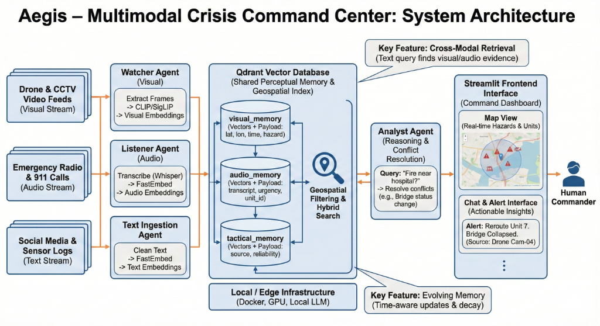

# Aegis — Multimodal Crisis Command Center

**AI-powered situational awareness for crisis operations.**  
Aegis fuses **video, image, audio, and text** into a unified vector memory, then grounds LLM answers in retrieved evidence — with planner/critic agents, provenance logging, and a live operational dashboard.



---

## Why this project

During disasters, critical signals are scattered across CCTV, radio traffic, field photos, and social/tactical reports. Analysts lose time stitching modalities by hand.

Aegis treats crisis intelligence as a **multimodal retrieval + agentic reasoning** problem:

1. **Ingest** heterogeneous feeds through specialized agents  
2. **Index** them in modality-aware vector collections (Qdrant)  
3. **Retrieve** with hybrid vector + keyword/metadata filtering  
4. **Reason** with tool-using LLMs, then **verify** with a critic / autonomous analyst  
5. **Present** grounded answers, map overlays, and alerts to operators

Built as a portfolio-grade research system demonstrating production-minded patterns: fallback LLMs, episodic memory, retrieval provenance, and evaluation harnesses.

---

## Features

### Multimodal ingestion agents
| Agent | Input | What it does |
|-------|--------|----------------|
| **Watcher** (`watcher_agent.py`) | Video | YOLO-World hazard detection + CLIP frame indexing |
| **Image** (`image_agent.py`) | Images | OCR, open-vocab detection, geospatial tagging |
| **Listener** (`listener_agent.py`) | Audio | STT, MP3→WAV, geocoding into audio memory |
| **Text** (`text_agent.py`) | Text / SITREPs | Social & tactical report embedding |

### Agentic intelligence core
- **Planner** — decomposes multi-step operational queries  
- **Critic** — checks hallucinations, citations, and safety warnings  
- **Episodic memory** — multi-turn context (“is *it* safe there?”)  
- **Autonomous analyst** — cross-validates visual hazards with audio intel  
- **LLM manager** — multi-model fallback (Llama-3.3-70B → Mixtral → Llama-3.1-8B)  
- **Retrieval provenance** — every answer logs query, evidence IDs, confidence  

### Command dashboard (Streamlit)
- Crisis operational map  
- Multimodal semantic search  
- Safety AI chat with confidence badges & plan visualization  
- Verified live alerts  

---

## Use cases

| Scenario | How Aegis helps |
|----------|-----------------|
| **Urban flooding** | Index CCTV frames + radio transcripts + civic reports; ask “flood risk near Chennai marina?” with cited evidence |
| **Cyclone / severe weather** | Fuse warning text, field audio, and imagery into one searchable memory |
| **Infrastructure failure** | Detect collapse-related visuals (YOLO-World) and correlate with tactical notes |
| **EOC briefing** | Operators query the dashboard in natural language instead of hunting folders |
| **Research / teaching** | End-to-end lab for multimodal RAG, agent tooling, and retrieval evaluation |

> **Important:** Aegis is a research / demo command-center prototype. Critical decisions must remain **human-in-the-loop**.

---

## Tech stack

| Layer | Choice | Why |
|-------|--------|-----|
| Vector DB | Qdrant Cloud | Hybrid vector + payload filters |
| Text embeddings | `BAAI/bge-small-en-v1.5` (384d) via FastEmbed | Fast local CPU inference |
| Visual embeddings | CLIP ViT-B/32 (512d) | Cross-modal image/frame search |
| Detection | YOLO-World (open vocabulary) | Hazard classes without fixed taxonomy only |
| Reasoning | Groq (Llama family) | Low-latency tactical Q&A |
| UI | Streamlit | Rapid ops dashboard |
| Geo | Nominatim / geopy | City-level location grounding |

Deep dive: [docs/ARCHITECTURE.md](docs/ARCHITECTURE.md) · Research & experiments: [docs/RESEARCH.md](docs/RESEARCH.md)

---

## Quick start

### Prerequisites
- Python **3.10+**
- [Qdrant Cloud](https://cloud.qdrant.io/) URL + API key  
- [Groq](https://console.groq.com/) API key  

### Install
```bash
git clone https://github.com/GokulRavi1/Aegis-Multimodal-Crisis-Command-Center.git
cd Aegis-Multimodal-Crisis-Command-Center
pip install -r requirements.txt
```

### Configure
Create a `.env` in the project root:

```ini
QDRANT_URL=https://your-cluster.qdrant.io
QDRANT_API_KEY=your-api-key
GROQ_API_KEY=your-groq-key
```

### Run (separate terminals)
```bash
# Ingestion
python watcher_agent.py
python image_agent.py
python listener_agent.py
python text_agent.py

# Intelligence
python analyst_agent.py

# Dashboard → http://localhost:8501
streamlit run dashboard.py
```

Drop files into the `_inbox/` hot folders to trigger ingestion.  
Full walkthrough, troubleshooting, and reset steps: **[SETUP.md](SETUP.md)**.

### Evaluate
```bash
python tests/benchmark.py
```
See [docs/RESEARCH.md](docs/RESEARCH.md) for methodology, metrics, and early experiment results.

---

## Project structure

```text
Aegis-Multimodal-Crisis-Command-Center/
├── dashboard.py              # Streamlit command center
├── *_agent.py                # Ingestion + planner/critic/analyst agents
├── memory_manager.py         # Embedding lifecycle, TTL, confidence
├── llm_manager.py            # Multi-model LLM fallback
├── retrieval_tools.py        # RAG tool interface
├── retrieval_logger.py       # Provenance / audit trail
├── episodic_memory.py        # Multi-turn session memory
├── geo_utils.py              # Geocoding helpers
├── config.py                 # Shared configuration
├── docs/
│   ├── ARCHITECTURE.md       # System design
│   └── RESEARCH.md           # Problem, method, experiments
├── tests/                    # Benchmarks & unit checks
├── SETUP.md                  # Detailed setup
├── system_architecture.png   # Architecture diagram
└── LICENSE                   # MIT
```

---

## Research highlights

Aegis explores **multimodal RAG for crisis situational awareness**:

- Separate **visual (512d)** and **text/audio (384d)** memories with shared operational payloads  
- Agent tooling: search-vs-answer decisions, explicit planning, critic verification  
- Evaluation harness tracking **Precision@k**, latency, and retrieval provenance  

Early bench runs and analysis (including limitations on a small demo corpus) are documented in **[docs/RESEARCH.md](docs/RESEARCH.md)**.

---

## Roadmap

- [ ] Sparse + dense hybrid search (e.g. BM25 + vectors)  
- [ ] Stronger location-aware re-ranking  
- [ ] PII redaction module  
- [ ] Multi-language OCR / STT  
- [ ] Edge / offline deployment mode  
- [ ] Real-time streaming ingestion  

---

## Contributing

Issues and PRs are welcome. For local setup, follow [SETUP.md](SETUP.md). Please keep changes focused, documented, and free of secrets (never commit `.env`).

---

## License

This project is released under the **[MIT License](LICENSE)** — free to use, modify, and distribute with attribution.

---

## Acknowledgments

- [Qdrant](https://qdrant.tech/) · [Groq](https://groq.com/) · [Ultralytics YOLO-World](https://docs.ultralytics.com/) · [FastEmbed](https://qdrant.github.io/fastembed/) · OpenStreetMap / Nominatim  

Built by **GokulR** as an open research system for multimodal crisis intelligence.
