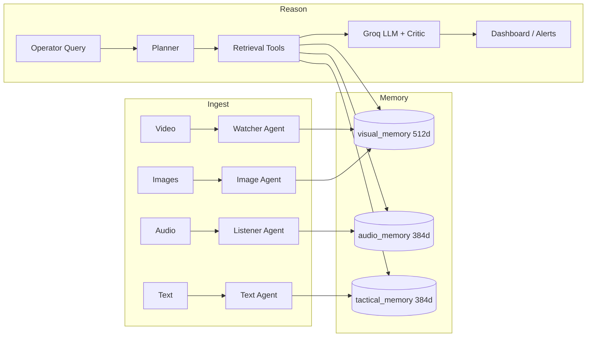

# Research Notes — Aegis Multimodal Crisis Command Center

**Status:** Early-stage research prototype · **License:** MIT  
**Focus:** Multimodal retrieval-augmented generation (RAG) for crisis situational awareness

This document combines a concise research write-up with honest experimental notes. It is meant for readers who want the *why* and *how* behind Aegis — recruiters, researchers, and engineers evaluating the system design.

---

## 1. Problem statement

Crisis operations centers receive heterogeneous signals:

- **Visual:** CCTV / drone / field photos  
- **Audio:** radio nets, voice notes  
- **Text:** SITREPs, social snippets, warning bulletins  

These streams are usually siloed. Analysts must manually correlate “what was seen,” “what was heard,” and “what was written,” under time pressure. Hallucinated or uncited AI answers are unacceptable in safety-critical contexts.

**Research question:**  
Can a modality-aware vector memory plus tool-using LLM agents produce *grounded*, *auditable* situational answers across video, image, audio, and text?

---

## 2. Related ideas (positioning)

Aegis sits at the intersection of:

| Area | Relevance to Aegis |
|------|--------------------|
| Multimodal embeddings (CLIP, etc.) | Shared visual search space for frames/images |
| Dense retrieval + RAG | Evidence-grounded LLM answers |
| Open-vocabulary detection (YOLO-World) | Hazard discovery without fixed class lists only |
| Agentic LLM workflows | Planner / critic / tool-choice loops |
| Provenance & human-in-the-loop AI | Audit trails for operational trust |

Aegis is **not** a production EOC replacement. It is a **systems research prototype** that implements these ideas end-to-end.

---

## 3. Method

### 3.1 System overview



Full component detail: [ARCHITECTURE.md](ARCHITECTURE.md).

### 3.2 Memory model

| Collection | Dim | Encoder | Content |
|------------|-----|---------|---------|
| `visual_memory` | 512 | CLIP | Images & video frames |
| `audio_memory` | 384 | BGE-small | Transcripts |
| `tactical_memory` | 384 | BGE-small | Text reports |
| `session_memory` | 384 | BGE-small | Working / episodic context |

Payloads carry operational metadata (modality, timestamp, disaster type, confidence, location, source) so retrieval can combine **dense similarity** with **filters / keywords**.

### 3.3 Retrieval pipeline

1. Embed the query (CLIP vs BGE depending on target collection)  
2. Vector search with score threshold  
3. Keyword / location post-filtering  
4. Format top‑k evidence with citations  
5. LLM generation under grounding instructions  
6. Log provenance (`retrieval_logger.py` → `retrieval_logs.json`)

### 3.4 Agent stack

| Module | Role |
|--------|------|
| Ingestion agents | Continuous hot-folder watchers → embeddings + metadata |
| Planner | Decompose complex multi-hop questions |
| Critic | Reduce unsupported claims; enforce citation / safety checks |
| Analyst | Background cross-check of visual vs audio signals |
| Episodic memory | Resolve references across turns |
| LLM manager | Fallback chain for rate-limit resilience |

### 3.5 Evaluation protocol

Harness: `tests/benchmark.py`

**Metrics**
- **Precision@k** — fraction of top‑k hits matching expected disaster (+ location when specified)  
- **Latency (ms)** — end-to-end retrieval timing  
- **Hit inspection** — qualitative review of ranked evidence  

**Protocol notes**
- Small curated query set (demo corpus scale)  
- Strict relevance: wrong location or mismatched disaster type counts as irrelevant  
- Results are **exploratory**, not a large-scale academic leaderboard claim  

---

## 4. Experiments & succession of results

### 4.1 What “success” means in this stage

For a systems prototype, success is layered:

| Level | Criterion | Status |
|-------|-----------|--------|
| **L1 — Pipeline** | Multimodal ingest → index → retrieve → answer → log | Achieved |
| **L2 — Grounding UX** | Citations, confidence badges, provenance logs | Achieved |
| **L3 — Agentic control** | Planner / critic / analyst loops operational | Achieved |
| **L4 — Retrieval quality** | High Precision@k on diverse queries | **Partial / early** |
| **L5 — Ops readiness** | Offline, multilingual, PII, streaming | Future work |

Recruiters and reviewers should weigh **L1–L3 engineering depth** heavily; **L4** is where research continues.

### 4.2 Early benchmark snapshot

Source file: `benchmark_results.json` (run timestamp `2026-02-05`).

| Setting | Value |
|---------|-------|
| Queries | 5 |
| k | 5 |
| Avg latency | **~1944 ms** |
| Avg Precision@5 | **0.08** (strict labeling on a small corpus) |

**Per-query qualitative succession**

| Query | Observation | Takeaway |
|-------|-------------|----------|
| `flood in Chennai` | Top hit was a Chennai flood audio source (score ~0.81); P@5 = 0.2 under strict geo match | Location-aware audio retrieval can surface the right incident |
| `Bengaluru urban flooding` | Strong top hit on Bengaluru flood text (~0.87); P@5 = 0.2 | Text memory retrieves well when corpus contains the event |
| `cyclone warning Kerala` | Hits skewed to flood / infrastructure visuals in Kerala region; P@5 = 0.0 | Semantic neighbors ≠ exact disaster-type match; need better type filtering / rerank |
| `bridge collapse emergency` | Infrastructure-collapse visual ranked high, but label mismatch vs “collapsed building”; P@5 = 0.0 | Taxonomy / synonym alignment is required for fair scoring |
| `fire hazard alert` | No fire-labeled items in demo set → unavoidable low precision | Corpus coverage bounds measurable quality |

### 4.3 Interpretation (honest)

**What worked**
- End-to-end multimodal indexing and search  
- High-similarity top hits for covered flood scenarios (Chennai / Bengaluru)  
- Provenance logging for every retrieval path  
- Stable ~2s latency class including remote vector + model stack (demo environment)

**What limited the numbers**
- Tiny, imbalanced demo corpus (missing fire / cyclone exemplars)  
- Strict dual constraint (disaster **and** location)  
- Label synonym gaps (`infrastructure collapse` vs `collapsed building`)  
- Dense similarity alone without strong sparse/geo reranking  

**Design implication:** The architecture is sound for a command-center prototype; retrieval quality now needs **dataset scale + hybrid ranking**, not a rewrite of the agent concept.

---

## 5. Ablations & next experiments (planned succession)

Suggested experimental sequence for anyone extending this work:

1. **Corpus scale-up** — balanced hazard types + multi-city coverage  
2. **Synonym / ontology map** — normalize disaster labels before scoring  
3. **Hybrid search** — BM25 / sparse + dense fusion  
4. **Geo re-rank** — hard filter or boost by bounding box / city token  
5. **Critic ablations** — measure citation precision with vs without critic  
6. **Latency profile** — break out embedding vs Qdrant vs Groq time  

Each step should re-run `python tests/benchmark.py` and append a dated section here.

---

## 6. Ethics, safety, and limitations

- **Human-in-the-loop:** Do not treat model output as authoritative for life-safety decisions.  
- **Hallucination risk:** Mitigated by citation prompts + critic; not eliminated.  
- **Bias:** Detectors and geocoders may underperform on region-specific hazards / sparse OSM areas.  
- **Privacy:** No default PII redaction yet — avoid uploading sensitive personal data.  
- **Language:** English-centric OCR / STT in the current build.  
- **Scale:** Validated at demo scale (~thousands of points), not national EOC load.

---

## 7. Reproducibility

```bash
# Environment
pip install -r requirements.txt
# Configure QDRANT_URL, QDRANT_API_KEY, GROQ_API_KEY in .env

# Ingest sample modalities via agents + _inbox/
# Then evaluate:
python tests/benchmark.py
```

Artifacts:
- `benchmark_results.json` — numeric summary  
- `retrieval_logs.json` — per-query provenance  

Setup details: [../SETUP.md](../SETUP.md)

---

## 8. Citation

If you use or build on Aegis:

```text
GokulR. Aegis: Multimodal Crisis Command Center.
GitHub repository, 2026. MIT License.
```

---

## 9. Summary for reviewers

Aegis demonstrates a **complete multimodal crisis-intelligence stack**: specialized ingestion agents, dual-dimension vector memory, retrieval tooling, planner/critic verification, and an operator dashboard with audit logs.

Early automated Precision@k on a small demo set is **low under strict scoring**, which is expected and documented. The research value is the **working system + evaluation path + clear next experiments**, not a claim of SOTA retrieval accuracy.

For the product narrative and quick start, see the root [README.md](../README.md).
